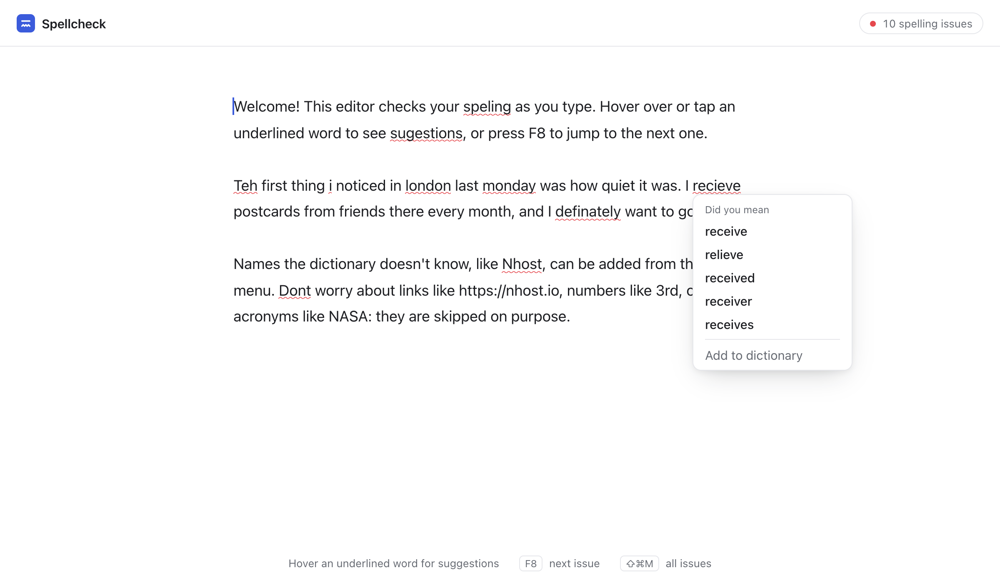
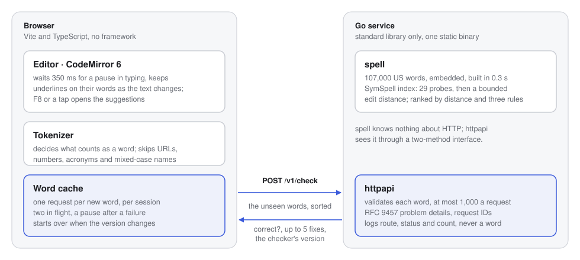
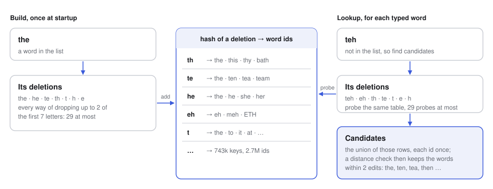
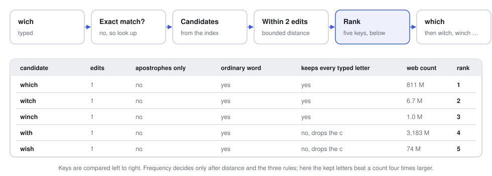
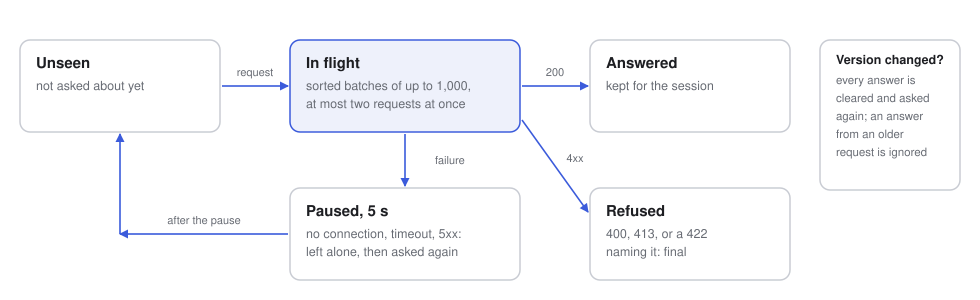
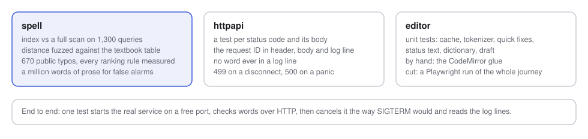

# Spellcheck

An editor that underlines misspelled English words as you type and suggests fixes. A small Go service does the checking against a US English dictionary of 107,000 words; the editor runs in the browser.

The work took about three hours. The main path is built and measured; the details and edge cases I noticed along the way but chose not to chase are listed near the end, each with what it would take.



## Run it

You need Go 1.27 (an older `go` downloads it by itself) and Node 22.12 or newer.

```bash
make dev
```

The API listens on `127.0.0.1:8080`, the editor is at http://localhost:5173, Ctrl-C stops both. The first run compiles the service and installs the npm packages, so give it a minute. Without make: `go -C backend run ./cmd/spellcheck` in one terminal, `npm --prefix frontend install` and `npm --prefix frontend run dev` in another. `make test` runs everything, `make lint` needs golangci-lint, `make bench` and `make accuracy` reproduce the numbers below, and `make build` produces the binary and the static editor, which expect one reverse proxy in front of both, as under Operating it. CI runs the linter, the tests and the build on every push to main.

## How I approached it

The brief is open on purpose, so I started by writing down what I was assuming and what I was not going to build:

- English means US English, one dictionary. The generator can produce a British one instead.
- One person, in one browser. No accounts, nothing stored on the server; the browser keeps the draft and a personal dictionary.
- Spelling, not grammar. Each word is judged on its own, so "form" typed for "from" passes.
- Prototype-sized text, up to about 100k characters.
- The text is private. The server receives distinct words, never the text, and never logs a word.

Then I broke the problem into four questions, ordered by how much each one decides whether the result is any good. For each, the choice I made, then the options I weighed and why they lost, folded so the page stays short, then the verdict in a line. Some I measured and some I ruled out on paper; I say which.

**1. Which words count as correct?** The word list decides false alarms more than any algorithm does, and the biggest list is the wrong one: a list that knows "calender" can never flag it. I took ESDB, which SCOWL became: curated for spell checkers, with capitals, contractions and possessives, and in sizes, where 60 is the point at which a smaller list starts flagging ordinary words and a larger one starts accepting rare ones that hide typos. It has no counts, so the ranking takes Norvig's, from Google's web corpus, at a cost I knew going in: they ignore case, and they come under research-use terms.

<details>
<summary>The options I weighed, and why each lost</summary>

- **SymSpell's own list**, 82,000 words with counts under the MIT license. It would have saved me the generation script, but it is lowercase only, so "I", "London" and a sentence-opening "The" would each need a special case, and it flags "favorite" and "theater" while accepting "calender".
- **Hunspell's en_US dictionary**: the same SCOWL words, affix-compressed. Expanding the affixes is work that buys nothing when the expanded list is a download away.
- **A raw list of 370,000 words**: every rare entry in it is a typo it can no longer flag.
- **A list cut from a corpus by frequency**: the web spells badly. In Norvig's counts "alot" occurs 5.9 million times and "recieve" 1.4 million, so any threshold low enough to keep real rare words keeps the common misspellings too.
- **Counts from Google Books instead of the web**: the cleaner license, which is why the notice names it for shipping, but older language. That is a swap in the generator and a re-run of `make accuracy`, not a design change.

</details>

**So, ESDB at size 60, ranked by Norvig's counts.** It flags what writers get wrong and accepts what they mean, with capitals and apostrophes intact, which SymSpell's list lacks; the bigger lists trade false alarms for missed typos; Hunspell's dictionary is the same data in a shape that needs more code. The price is a generation script and a licensing note on the counts.

**2. How do I find candidates fast enough to check on every pause?** First the distance. Optimal string alignment counts a swap of neighbours as one edit, because "teh" and "recieve" are swaps, and it is bounded, so a check stops as soon as a word is clearly too far. Then the index: SymSpell's symmetric-delete idea. Every word is stored under every way of deleting up to two of its letters, a typo's own deletions probe the same table, and the distance check on the candidates makes the result exact. A lookup is 29 hash probes, then a distance check per candidate: a few hundred for a short typo, 759 for "teh". Its known cost is memory, and I paid part of it down with 64-bit hashes in place of string keys, which saved 15 MiB and a third of the startup time, measured during development; a collision only adds a candidate for the distance check to reject.

<details>
<summary>The options I weighed, and why each lost</summary>

- **A full scan** with the bounded distance: milliseconds per word, fine for one, hopeless for a request of a thousand, and the easiest to get right. Measured, and kept as the oracle the index is tested against.
- **Norvig's way**, generating every string within two edits and looking each one up: the simplest to write, and it explodes, over a hundred thousand strings for a nine-letter word, per word, per pause.
- **A BK-tree** prunes a metric space, and this distance is not a metric: "ca" to "abc" is three edits though "ac" sits one edit from each, so the tree would prune away right answers.
- **A trie walked with the distance row**: exact, but a few hundred thousand pointers for the cache to miss, and at two edits a short typo visits most of the top of the tree.
- **A trigram index**, as Postgres and the search engines offer: approximate by design, and "teh" shares no trigram at all with "the".
- **A Levenshtein automaton**, as Lucene builds one: the fastest lookups there are, and a project of its own, for an index that already answers in microseconds, far under a network round trip.
- **A search engine or a database** doing the fuzzy matching: a network hop and a cluster for a problem that fits in 75 MiB of one process.
- **Phonetic keys** beside the index, Metaphone or the like, would find "fonetik" at the price of candidates far from what was typed; worth it only with a ranker that can weigh them, which is next-step material.
- **Other distances.** Plain Levenshtein has no swap, so "ten" and "tea" would outrank "the" for "teh". True Damerau-Levenshtein is a metric, which only a metric tree needs, and pays an alphabet-indexed table for one case, a swapped pair edited again, that typos do not produce. Jaro-Winkler is a similarity, not an edit count, so there is no "within two edits" for an index to promise.

</details>

**So, a symmetric-delete index over a bounded optimal string alignment distance.** Exact at two edits, 29 probes and a few hundred distance checks a lookup, microseconds a word, and nothing to tune. The scan is too slow to serve, edit generation too slow to compute, the tree prunes wrongly on this distance, the automaton costs a project for a gain below the network, and an engine costs a cluster. The price is 75 MiB of memory, and the pointer-free index that cuts it to a third is in the next steps.

**3. Which candidate goes first?** Distance, then frequency, is where Norvig's corrector stops, and here it gets 75% and 73% of his test typos right, against the 75% and 68% he reports. I wrote rules for how people type, added them one at a time, and let the validation sets decide: three kept, four tried and dropped, every row of the table below reproducible with one command.

<details>
<summary>The options I weighed, and why each lost</summary>

- **A noisy-channel model**, as Kernighan, Church and Gale set it out, with the cost of each kind of slip learned from a corpus of real misspellings: the right model, and the first thing I would build next. I had no such corpus inside the window, and a model I could not measure would have been worse than rules I could.
- **Keyboard distance** as a tie-breaker: measured, and it lowered the first-place rate on both sets.
- **The words around a flagged one**: the only way to catch "form" for "from". It needs the text, which the API does not see by design, so it belongs behind the API, for flagged words only, where the cache and the privacy property survive.
- **A neural model that rewrites the sentence**: the best quality with context, and wrong for this product: hundreds of milliseconds a call, the text leaves the browser, and the answer can differ between runs, so nothing can be cached.

</details>

**So, distance first, then the three rules that survived measurement, then frequency.** Each rule bought first-place accuracy on real misspellings or it was dropped, and every row reproduces with one command. Frequency alone leaves five typos in a hundred on the table; a learned model needs data I did not have; context needs the text the API does not see; a neural model costs the privacy and the cache I would not give up.

**4. How should it feel while someone types?** The API takes a batch of words, not the text, so an answer depends on the word alone: the browser caches every answer for the session, sends each distinct word once, sorted, and the server never sees the text. The cost is real: the tokenizer lives in the client, and a word-level checker cannot catch "form" typed for "from". For scheduling I took CodeMirror's lint extension over a debounce of my own, because it already maps underlines through edits and drops results computed for text that has since changed. For outages, a fixed five-second pause with at most two requests in flight, not exponential backoff: one tab is not a fleet, and the cap already bounds what a tab can send during an outage.

<details>
<summary>The options I weighed, and why each lost</summary>

- **A document-level API**, the text in and positions out: the simplest client, and the server would see everything, every pause would send everything again, and nothing could be cached.
- **GET with the words in the query string**: proxies could cache it, which is exactly the problem, since the words would land in every access log on the way. POST, and the server never logs a word.
- **A WebSocket per session**: nothing to gain over one POST per pause, and plain HTTP keeps retries, request IDs and curl.
- **Everything in the browser**: a WASM build of the same package would check offline, but the index is 75 MiB, every list update would be a client release, and the brief asks for a service.
- **Monaco, ProseMirror, or contenteditable by hand**: an IDE's weight, a rich-document model, or a project of its own. CodeMirror's lint extension already does the hard part.
- **A framework, or another language**: two routes need no router beyond the standard library's, which has had method patterns since Go 1.22. One language for both halves was tempting, but Go gives each request its own goroutine, so a 0.22 s request stalls no one else, and it leaves the index's memory layout to me.

</details>

**So, a batch of words over POST, CodeMirror's lint extension, a cache keyed by the checker's version, and a fixed pause on failure.** The text stays in the browser, each word is checked once per session, and the underlines survive editing without code of mine. The document API and GET give up the privacy; the socket and the heavier editors add weight for nothing I needed; a WASM build gives up the service the brief asks for.

The riskiest piece was the index: a bug there silently drops the right suggestion and nothing looks wrong. So it was compared with a brute-force scan of the whole dictionary from the start, before anything else was built on it.

## The decisions

| Decision | Why | Cost |
|---|---|---|
| Write the checker, don't wrap Hunspell or a library | No cgo, full control of the data and the ranking, and the checker is the point of the brief | No affix rules, no other languages for free |
| A word-level batch API, not a document-level one | An answer depends only on the word, so the browser can cache every answer and the server never sees the text | Tokenization lives in the client |
| A hand-written SymSpell index with a bounded edit distance | 14 to 40 µs to find a typo's candidates, against 1 to 5 ms for a full scan | 75 MiB of memory, built in 0.3 s at startup |
| The ESDB size-60 US word list, ranked by web counts | Curated for spell checking, with capitals, contractions and possessives | A generation script, and a licensing caveat on the counts |
| CodeMirror 6 with its lint extension | It already handles typing pauses, underlines that follow the text, and keyboard access | Plain text only |
| The Go standard library only | Two routes need no framework; problem details and request IDs cost little | Validation and API docs are written by hand |

The first row is the one I'd defend hardest. Hunspell would have given me affix rules and forty languages, but through cgo, and the brief is about validating words and suggesting fixes, so that is where I wanted to show my work rather than wrap it. A product that needed those would wrap Hunspell behind the same two-method interface and keep everything else. The rest of this file is the reasoning behind the other rows, with the measurements that decided them.

## How it fits together

<picture>
  <source media="(prefers-color-scheme: dark)" srcset="docs/architecture-dark.svg">
  
</picture>

Only the words the cache hasn't seen cross the wire, sorted, so a request carries the text's vocabulary, not the text, its order or its repetitions. The logs carry a request ID, never a word. Inside the service, `spell` knows nothing about HTTP, and `httpapi` sees it through a two-method interface.

## The index

<picture>
  <source media="(prefers-color-scheme: dark)" srcset="docs/index-dark.svg">
  
</picture>

Two words within two edits of each other share a deletion, so precomputing the deletions turns a search into a few hash probes. Only the first seven letters of a word are indexed: longer words share their prefix's entries, which keeps the table small, and the distance check on whole words keeps the result exact, which the comparison with the full scan confirms.

## Ranking

<picture>
  <source media="(prefers-color-scheme: dark)" srcset="docs/ranking-dark.svg">
  
</picture>

Fewer edits always wins. At the same distance, three rules decide before frequency does: a fix that only adds or removes apostrophes, so "dont" gets "don't" before "done"; ordinary words before names and abbreviations, because the counts ignore case and "Th" would otherwise inherit every lowercase "th"; and a fix that keeps every typed letter, because people leave letters out more often than they type wrong ones. Capitals follow the input, so "london" gets "London", and a fix that keeps none of the typed letters is left out, so a two-letter word from another alphabet does not get "of". A word that is two words run together, "alot", "infront", "thankyou", gets the pair too. Word counts alone can't tell "a lot" from "short end", and putting pairs first by them cost four typos on the sets below, so a pair takes the last of the five places unless the best single-word fix is one of its parts.

I added the rules one at a time and measured each on Peter Norvig's two public sets of real misspellings. No rule was written against them, but the last ones were chosen by their effect on them, so they are validation sets, not a held-out test. `make accuracy` prints every row, including the four rankings I tried and dropped.

| Ranking | Set 1, first / top five | Set 2, first / top five | Golden 60, first |
|---|---|---|---|
| Distance, then frequency | 75% / 91% | 73% / 88% | 51 |
| Plus apostrophes | 75% / 91% | 73% / 88% | 55 |
| Plus names after ordinary words | 76% / 91% | 73% / 88% | 55 |
| Plus keep what was typed, the shipped ranking | 80% / 92% | 78% / 88% | 59 |
| A four-way order of edit kinds instead, dropped | 78% / 92% | 76% / 86% | 57 |
| Plus a keyboard-neighbour tie-breaker, dropped | 79% / 92% | 76% / 87% | 59 |
| Kept letters before distance, dropped | 76% / 91% | 75% / 85% | 55 |
| The names rule for short entries only, dropped | 80% / 92% | 77% / 88% | 59 |

## The cache

<picture>
  <source media="(prefers-color-scheme: dark)" srcset="docs/cache-dark.svg">
  
</picture>

There is no cache on the server: a correct word costs nanoseconds, a typo microseconds, and the browser already remembers every answer. What that cache needed was a version to key on, and it had to cover the ranking code as well as the word list, because a ranking change would otherwise leave every open tab with stale suggestions. So the version is the list's hash plus the build's commit. During a rollout two builds can answer in turn; the cache ignores answers from a version it has left behind and asks again, a bounded number of times.

## How I know it works

<picture>
  <source media="(prefers-color-scheme: dark)" srcset="docs/verification-dark.svg">
  
</picture>

Breaking the index on purpose, during development, made 549 of 1,000 random queries fail the comparison with the full scan, which is how I know the comparison bites. The other half of quality is false alarms: a million words of public-domain books get 20.5 underlines per thousand, half of them names, the rest mostly British spellings and the vocabulary of a surgery manual in the corpus. That is the word list's choice, not the algorithm's.

| | |
|---|---|
| Build the dictionary at startup | 0.3 s, 75 MiB live heap |
| Check a correct word | 60 ns, no allocation |
| Check a typo | 14 µs for a long word; 80 to 90 µs for a short one with hundreds of candidates, 40 of them finding the candidates and the rest ranking them |
| The largest request, 1,000 short typos | 0.22 s of CPU |

## Where the time went, and what I cut

The strategy was risk first and measurement always. Most of the time went into the core: the edit distance, the index, the data, the ranking, in that order. A real share of it was spent thinking rather than typing, on the strategy, the architecture and the decisions above, because choosing well was cheaper than replacing: the list and the index are the two pieces everything else sits on.

Each piece was then built together with the test that would catch it being wrong, before the next piece depended on it: the distance is fuzzed against the textbook full-table version; the index is compared with a full scan of the whole list; the generator refuses to run if ESDB has moved past the pinned revision; every ranking rule was measured before it was kept. That is where the quality of the product is decided, and it is what the brief asks about.

Three habits carry the stability. The dictionary never changes after it is built, so there are no locks and every request is independent of every other. Everything is bounded: two edits, 64 letters, 1,000 words a request, 1 MiB a body, two requests in flight, five rounds of asking again, ten seconds to drain. And the scratch space a lookup needs is pooled, so a correct word allocates nothing and a typo twice, whatever the load.

What I expected to go wrong, and what I did about it before it did:

- **The index silently dropping the right word.** The comparison with the full scan came in the same commit as the index, and I broke the index on purpose to see that the comparison bites.
- **The distance wrong by one** on a swap or at the bound: fuzzed against the textbook version, with inputs long enough to leave the stack buffer.
- **The worst request**, a thousand short typos with hundreds of candidates each, was the benchmark from the start, and two changes were kept on its numbers: the distance rows moved to the stack, and the lookup's scratch into a pool with a bitset in place of a map for the candidates already seen. Together they took the request from a quarter of a gigabyte of garbage to under a megabyte, measured at the time, and from 275 ms to the 0.22 s above.
- **Data drifting under the tests.** The ESDB generator serves whatever is current, so the revision is pinned, the counts have a checksum, and a test pins the list's version: a change to the data cannot get through review unnoticed.
- **Stale answers after a deploy.** Every answer carries a version covering code and data; the cache ignores answers and failures from a version it has left behind; and two builds answering in turn during a rollout end in a pause, not a loop.
- **Words leaking into logs.** Requests are logged by route pattern, request IDs are issued by the server rather than copied from a header, and a test plants a word in a path and a query string and fails if it reaches a log line.
- **Clients that are hostile, or merely older.** The decoder rejects duplicate members and invalid UTF-8; a 422 points at each bad word so the client keeps the rest; unknown members are ignored, because rejecting them would stop a newer client from adding a field while an older server still ran.
- **Clients that leave, handlers that panic.** An abandoned request stops checking and is logged as 499; a panic becomes a 500 with the stack in the log.

The rest I found by using it as a writer would: "Teh" suggested "Th", because the counts ignore case, and that became the names rule; "pre-trained" was underlined, so the bound prefixes the list lacks are skipped; a fix straightened a curly apostrophe; and the tokenizer used a regex flag Safari 16 cannot parse, which left a blank editor there.

After the core, the editor took the most time: typing, outages, keyboard and touch. The HTTP layer took the least: a small, strict, documented contract. Then this file.

Three things the brief did not ask for made it in anyway: a draft that survives reloads, a personal dictionary and touch support. Each came from using the editor, and none took long.

Cut on purpose, each with how I'd do it:

- **A browser test of the whole journey.** Playwright against the real service: type "Teh recieve", see two underlines, apply "The", see the count drop, keep typing while a request is in flight, restart the API and watch checking resume. It is the one test that covers what I still check by hand.
- **A container image and a compose file.** A multi-stage build into a distroless image with a `healthcheck` subcommand, since distroless has no shell, and a compose file with a static server proxying `/v1`.
- **Metrics.** Request rate and latency per route; the logging middleware already has the route pattern, so labels stay low-cardinality. Readiness would be separate from liveness and fail first on SIGTERM.
- **An OpenAPI spec**, with server types and a TypeScript client generated from it, once there is a second client.
- **Rate limiting.** Per-client limits at the edge, and a semaphore in the handler behind them.

## What I'd do differently, and next

The test budget was a choice I'd shift. A wrong suggestion is silent, so the backend got a brute-force oracle, a fuzzer and accuracy floors; a broken editor is visible on first use, so the editor got hand testing. That was the right order for a prototype, but next time I'd automate the type, underline, fix journey in a real browser before adding HTTP edge cases.

I also chose the last ranking rules by their effect on the public misspelling sets, which turned them from a held-out test into validation sets. Next time I'd put one set aside and look at it once, at the end.

Next, in this order:

1. **A ranking learned from data.** Typo costs from a larger corpus of real misspellings such as Birkbeck's, and how often two words appear together, so that a pair like "a lot" can earn first place. Measured on a set kept untouched until the end.
2. **Context, for flagged words only.** Rerank the suggestions of an underlined word by its neighbours, which also catches "form" for "from". Only for flagged words, so the word cache and the privacy property survive.
3. **Large documents and memory.** Check only the visible part, and replace the map of slices with a compact, pointer-free index at a third of the memory.

## Details I left out

These are the edge cases I noticed and chose not to chase. None of them is a surprise; each is a known shape with a known cost.

- **Distance beats the kept letters.** "tounge" gets "lounge" first, because "lounge" is one edit away and "tongue" two. Putting the kept letters before distance fixes it and costs 20 typos on the validation sets, the row before last above, so it stays. The fix is a model of which typos people make, learned from more data than I have here.
- **Real-word errors pass.** "form" for "from" needs the neighbouring words, which the word-level API does not see; that is the second of the next steps. "cant" and "wont" pass the same way, since both are words in their own right, where "dont" gets "don't" only because "dont" is not one.
- **A pair never goes first on its own.** "alot" gets "a lot" as its last suggestion, not its first; that needs how often two words appear together, which the word counts don't say.
- **The names rule costs "Wensday"**, which gets "Weekday" before "Wednesday". Narrowing the rule to short entries fixes it and costs four typos on the second set, the last row above; without the rule altogether, "ETH" shows up for "teh".
- **An abbreviation that matches the typo exactly goes first.** "ot" gets "OT" before "to": a match that differs only in case is zero edits away, and distance decides before the names rule. It is the path that gives "london" its "London", and the list does not say which of its capitalized entries are names and which are abbreviations.
- **British spellings are flagged** by design; the generator takes a British list instead.
- **Two things in the editor I decided against adding chrome for:** "Add to dictionary" can't be undone, since an added word has no underline to hang a fix on and the way back would be a list of its own; and the issues panel jumps back to its first row after a fix, which is the lint extension's behaviour.

## Operating it

- One static binary with the list inside, no state; about 110 MiB resident per instance. A `-dictionary` flag loads a list from disk instead.
- The list is built before the listener opens, so `/healthz` up means ready. On SIGTERM the service stops accepting and gives in-flight requests ten seconds; the orchestrator has to stop routing before it signals.
- Every response the handler produces carries `X-Request-Id`, every error names it, and the log line has it with the route, status, duration and word count. The editor calls `/v1` on its own origin, so one reverse proxy in front of both and no CORS.

The contract, limits, status codes, flags and log fields are in [docs/api.md](docs/api.md).

## Data and licenses

The word list is generated by a script in `backend/internal/spell/data` from two pinned sources, plus a short `extra.txt` for words ESDB lacks, "ok" and the vocabulary of software work that the brief itself uses, "backend", "frontend", "tradeoffs", "timeboxing" and a few of their kind: the ESDB size-60 US list, MIT-style, notice alongside; and Norvig's word counts, which derive from Google's Web 1T corpus under research-use terms. That is fine for a prototype shared for review; before shipping anything I would swap the counts for SymSpell's MIT-licensed list and re-run `make accuracy` to see what it costs. The code is under the MIT license.
